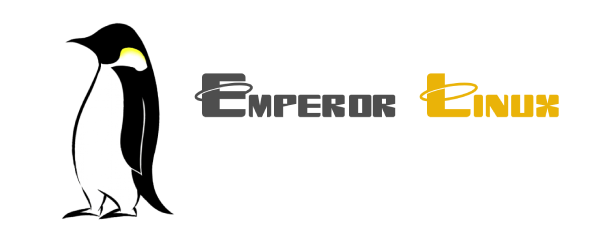

**Rolling-release speed. Granular control. Built-in security.**

An early-stage open-source Linux distribution engineered around three core principles: up-to-date package availability, zero-bloat manual configuration, and out-of-the-box defensive security utilities. Built for minimal overhead, total system ownership, and reliable operation on any network. Explore our repositories to follow development and track our early releases.